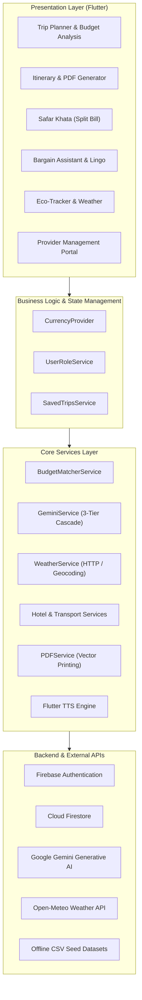

# 🏔️ SafarSathi (SastaSafar)
### *AI-Powered Budget Travel & Sustainable Tourism Companion for Pakistan*

[](https://flutter.dev)
[](https://dart.dev)
[](https://firebase.google.com)
[](https://ai.google.dev)
[](https://flutter.dev)

---

## 📖 Executive Summary

**SafarSathi** (*formerly SastaSafar*) is an intelligent, full-stack mobile travel management platform tailored specifically for the Pakistani tourism ecosystem. Built as a Final Year Project (FYP), the platform bridges critical information gaps in domestic tourism by combining **algorithmic budget optimization**, **generative AI trip guidance**, **linguistic text-to-speech tools**, **carbon footprint tracking**, and a **peer-to-peer verified local provider marketplace**.

Whether planning a solo backpacker trek to Hunza, a family getaway to Murree, or a cultural exploration of Lahore, SafarSathi protects travelers from arbitrary price gouging, ensures realistic financial feasibility, and fosters sustainable eco-conscious travel across Pakistan.

---

## ✨ Key System Features

### 1. 🎯 Dynamic Trip Planner & Budget Feasibility Engine
- **Input Validation & Date Sanity:** Enforces strict chronological date selection ($End \ge Start$) with instant duration computation.
- **1-Day vs. Multi-Day Intelligence:** Single-day excursions automatically allocate **0 overnight hotel stays** rather than falsely deducting room costs.
- **Group Multiplier Logic:** Dynamically scales meals, transport tickets, and curated activities across traveler counts (`1 to 100`) while computing realistic room occupancy.
- **Low / Impossible Budget Guard:** Prevents unrealistic planning by analyzing fixed transit and accommodation costs against the user's budget. Displays an amber advisory banner whenever a trip is financially unviable, offering actionable suggestions (shorten duration, switch to bus/train, or adjust budget) instead of faking reduced provider costs.
- **Dynamic Financial Health Score:** Calculates an authentic budget feasibility score based on surplus reserves and subsistence allowances.

### 2. 📊 Budget Analysis & Smart Day-Wallet Sync
- **Locked Expense Allocation:** Round-trip transit and hotel commitments are locked and deducted upfront from the daily discretionary allowance.
- **Daily Itinerary Wallet:** Ensures daily activities and dining choices stay strictly within the remaining per-day spending limit.
- **Multi-Currency Support:** Seamless on-the-fly currency conversion (PKR, USD, EUR, GBP, AED, SAR) with synchronized formatting across the entire app.

### 3. 🗺️ Curated Itineraries & Multi-Day PDF Export
- **Smart Activity Tiering:** Activities are categorized into Free, Budget, and Premium experiences aligned with the user’s designated daily wallet.
- **Custom Day-Budget Override:** Interactive slider allows users to reallocate funds between trip days safely without exceeding the total budget.
- **Production PDF Reports:** Generates clean, vector-rendered itinerary summaries formatted by day, including non-ASCII currency support, complete budget breakdowns, and transit instructions.

### 4. 🤝 Safar Khata (Group Bill Splitter)
- **Zero-Sum Debt Minimization:** Computes net balances among group members and minimizes the total number of transactions required to settle up.
- **Duplicate Debt Elimination:** State-tracked settlement toggles prevent phantom debt duplication when editing shared trip receipts.

### 5. 🗣️ AI Bargain Assistant & Urdu Counter-Offers
- **Regional Market Price Bands:** Evaluates merchant quotes against authentic price brackets for souvenirs, dry fruits, street food, and private jeep hire.
- **Contextual Urdu Rebuttals:** Provides phonetic Urdu responses and culturally authentic counter-offers to help travelers negotiate fair prices with local vendors respectfully.

### 6. 🌐 Regional Lingo & Native Text-to-Speech (TTS)
- **Dialect Coverage:** Curated phrasebooks covering **Urdu, Punjabi, Pashto, Sindhi, Balochi, Shina, and Balti**.
- **Speech Engine Lifecycle:** Integrated with native TTS featuring active language availability checks, phonetic spelling guides, and error/cancellation handlers to prevent UI freezing.

### 7. 🌿 Eco-Tracker & Carbon Footprint Calculator
- **Modal Emission Modeling:** Accurately computes $kg CO_2$ emissions per passenger-kilometer (Car $\approx 0.17$ kg/km, Bus $\approx 0.05$ kg/km, Train $\approx 0.04$ kg/km) across verified highway transit routes.
- **Eco-Warrior Achievements:** Rewards lower footprint choices with gamified badges and carbon-offset recommendations.

### 8. 🤖 SafarBot (Generative AI Assistant)
- **3-Tier Model Cascade:** Cascades queries across `gemini-2.5-flash` $\to$ `gemini-2.0-flash` $\to$ `gemini-2.0-flash-lite`.
- **Offline Resilience:** Enforces strict 10-second timeout guards and seamlessly falls back to local heuristic packing lists and offline FAQ knowledge bases when mobile networks drop in remote valleys.

### 9. 🌤️ Weather Advisories & Emergency SOS
- **Live Destination Forecasts:** Geocoded weather checks with snow/rain safety warnings and strict HTTP timeout guards.
- **One-Tap Emergency Assistance:** Direct-dial integration with national emergency lines (1122, Tourist Police, Highway Patrol).

### 10. 🏪 Dual-Role Architecture (Traveler & Local Provider Portal)
- **Role Switching:** Travelers can switch to Provider mode to register hotels, transport services, tours, or guide services.
- **Live Firestore Streaming:** Real-time vendor dashboards tracking active, verified, and pending service listings.
- **State Isolation:** Complete cache invalidation on logout to ensure zero cross-account data leakage.

---

## 🏗️ System Architecture



---

## 📂 Project Directory Structure

```text
lib/
├── core/
│   ├── constants/             # App colors, typography, strings, themes
│   ├── helpers/               # URL launcher and string formatting utilities
│   ├── models/                # Data models (User, Hotel, Transport, Attraction, etc.)
│   └── services/              # Core business services (BudgetMatcher, Hotel, Transport)
├── features/
│   ├── auth/                  # Login, Signup, Role Selection screens
│   ├── bargain/               # AI Bargain Assistant with Urdu rebuttals
│   ├── budget/                # Trip Planner, Budget Analysis, Health Score
│   ├── eco/                   # Eco-Tracker and Carbon footprint calculation
│   ├── itinerary/             # Day-by-day Itinerary, PDF export, activity timeline
│   ├── lingo/                 # Regional dialects and Text-to-Speech
│   ├── profile/               # User profile, notification preferences, settings
│   ├── provider/              # Provider portal, listing publish modals, performance
│   ├── safor_bot/             # SafarBot AI chat powered by Google Gemini
│   ├── split_bill/            # Safar Khata bill splitting algorithm
│   └── weather/               # Live destination weather advisories
├── firebase_options.dart      # Auto-generated Firebase configurations
└── main.dart                  # Application entry point & theme initialization
```

---

## 🛠️ Tech Stack & Dependencies

| Layer | Technologies / Packages |
| :--- | :--- |
| **Framework** | [Flutter](https://flutter.dev) (Dart 3.8+) |
| **Cloud & Backend** | [Firebase Core](https://pub.dev/packages/firebase_core), [Firebase Auth](https://pub.dev/packages/firebase_auth), [Cloud Firestore](https://pub.dev/packages/cloud_firestore) |
| **Artificial Intelligence** | [Google Gemini API](https://ai.google.dev) (`gemini-2.5-flash`, `gemini-2.0-flash`) |
| **State Management** | [Provider](https://pub.dev/packages/provider) |
| **Document Generation** | [pdf](https://pub.dev/packages/pdf), [printing](https://pub.dev/packages/printing) |
| **Audio & Speech** | [flutter_tts](https://pub.dev/packages/flutter_tts) |
| **Storage & Caching** | [shared_preferences](https://pub.dev/packages/shared_preferences), [path_provider](https://pub.dev/packages/path_provider) |
| **Networking & APIs** | [http](https://pub.dev/packages/http), Open-Meteo REST API |
| **Styling & UI** | [google_fonts](https://pub.dev/packages/google_fonts), [cupertino_icons](https://pub.dev/packages/cupertino_icons) |

---

## 🚀 Getting Started & Installation

### Prerequisites
1. **Flutter SDK:** Version `3.8.1` or higher. ([Install Guide](https://docs.flutter.dev/get-started/install))
2. **Android Studio / VS Code** with Flutter & Dart extensions.
3. **Android Device / Emulator** running Android 8.0 (API 26) or higher.

### Step 1: Clone Repository
```bash
git clone https://github.com/MuhammadAhsan-MASK/SafarSathi.git
cd SafarSathi
```

### Step 2: Install Dependencies
```bash
flutter pub get
```

### Step 3: Firebase Configuration
1. Ensure your `android/app/google-services.json` file is present in the `android/app/` folder.
2. Initialize Firebase via CLI if setting up a new project:
   ```bash
   flutterfire configure
   ```

### Step 4: Configure Gemini API Key
In `lib/features/safor_bot/services/gemini_service.dart`, supply your Google Gemini API key or inject it via environment variables:
```dart
static const String _apiKey = String.fromEnvironment('GEMINI_API_KEY', defaultValue: 'YOUR_API_KEY');
```

### Step 5: Run Application
```bash
# Debug Mode
flutter run

# Release APK Build
flutter build apk --release
```

---

## 👥 Final Year Project (FYP) Team

* **Department of Computer Science**
* **Project Name:** SafarSathi (SastaSafar)
* **Lead Developer / Author:** [Muhammad Ahsan](https://github.com/MuhammadAhsan-MASK)
* **Institution:** Riphah International University

